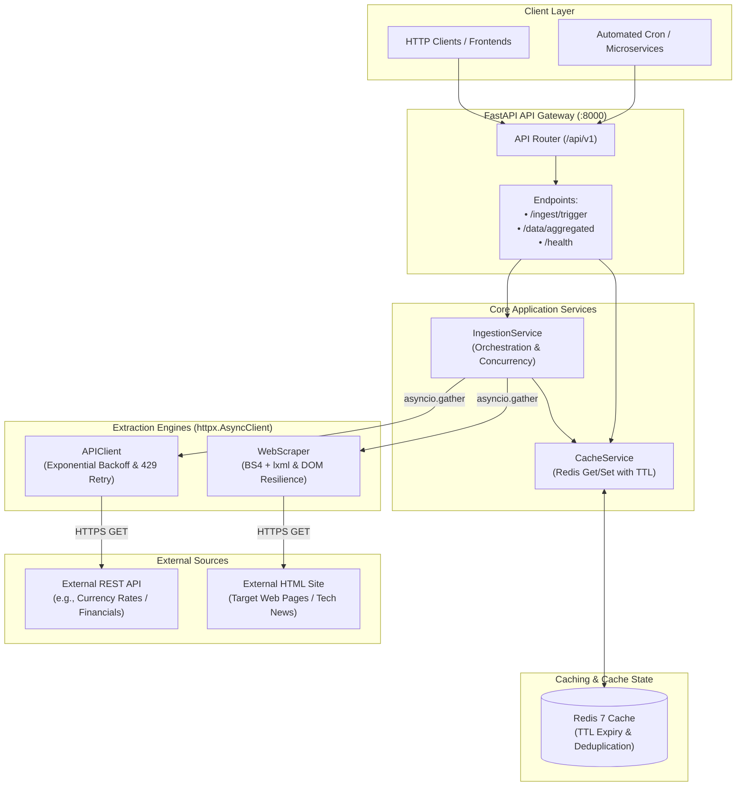

# Enterprise-Grade Multi-Source Data Ingestion Pipeline & API Gateway

An asynchronous, resilient, and enterprise-grade ETL data ingestion pipeline and high-performance API Gateway built with **Python 3.12**, **FastAPI**, **AsyncIO**, **HTTPX**, **BeautifulSoup4**, **Redis**, and **Pydantic v2**.

---

## 🏛️ System Architecture



---

## 🚀 Key Engineering Highlights

1. **Strict Modular Architecture**:
   - Clean layer separation: `Routers -> Services -> Ingestors -> Schemas -> Core`.
   - Dependency inversion pattern with injectable HTTP clients and Redis adapters.
2. **True Asynchronous Execution**:
   - Built on `asyncio` and `httpx.AsyncClient` for high-throughput non-blocking I/O.
   - External extraction sources run concurrently via `asyncio.gather(..., return_exceptions=True)`.
3. **Enterprise Resilience & Fault Tolerance**:
   - **Exponential Backoff**: Jittered exponential retries on network drops, timeouts, and `5xx` server errors.
   - **Rate-Limit Handling**: Automatic interception of HTTP `429 Too Many Requests` honoring `Retry-After` headers.
   - **Safe Baseline Fallbacks**: When third-party providers suffer extended outages, ingestors serve baseline cached payloads without crashing the gateway.
   - **DOM Structure Drift Resilience**: BeautifulSoup4 parsing handles missing CSS selectors, empty nodes, and altered layouts without uncaught exceptions.
4. **Intelligent Caching & Cache-Miss Fallback**:
   - Normalized records are cached in Redis with configurable TTL (default 300s).
   - Querying `/api/v1/data/aggregated` serves immediately from Redis; on a cache miss, it triggers transparent fallback extraction and warms the cache automatically.
5. **Type Safety & Data Contracts**:
   - 100% Pydantic v2 schemas (`NormalizedRecord`, `RawAPIPayload`, `RawScrapedItem`, `IngestionResponseSummary`).
   - Deterministic SHA-256 record IDs and payload checksums for change detection and deduplication.

---

## 📂 Repository Directory Layout

```
data_gateway/
├── app/
│   ├── api/
│   │   ├── v1/
│   │   │   ├── endpoints/
│   │   │   │   ├── ingestion.py       # POST /api/v1/ingest/trigger
│   │   │   │   ├── aggregator.py      # GET /api/v1/data/aggregated
│   │   │   │   └── health.py          # GET /api/v1/health
│   │   │   └── router.py              # Consolidated v1 router
│   ├── core/
│   │   ├── config.py                  # Pydantic BaseSettings (.env integration)
│   │   ├── redis.py                   # Async Redis connection pool manager
│   │   ├── exceptions.py              # Custom domain exception hierarchy & handlers
│   │   └── logging.py                 # Structured logging configuration
│   ├── ingestors/                     # Asynchronous Data Extraction Engines
│   │   ├── base.py                    # Abstract Base Class (BaseIngestor)
│   │   ├── api_client.py              # REST API client (httpx, retries, fallbacks)
│   │   └── web_scraper.py             # BS4 + lxml web scraper with custom User-Agent
│   ├── schemas/                       # Pydantic v2 Data Transfer Objects
│   │   ├── raw_data.py                # Raw DTOs directly from source
│   │   └── normalized_data.py         # Standardized canonical models
│   ├── services/                      # Business Logic & Orchestration
│   │   ├── ingestion_service.py       # Concurrent task runner & deduplicator
│   │   └── cache_service.py           # Resilient Redis cache get/set operations
│   └── main.py                        # FastAPI application initialization & lifespan
├── tests/                             # Complete test suite
│   ├── conftest.py                    # FakeRedis, mock HTTP, & ASGI test client fixtures
│   ├── test_api_client.py             # Network failures, 429 retries, & fallbacks
│   ├── test_scraper.py                # DOM shifts, missing tags, & scraper retries
│   └── test_gateway_api.py            # API routing, cache miss/hit lifecycle, health
├── .env.example                       # Documented environment configuration template
├── .gitignore                         # Comprehensive ignore rules
├── Dockerfile                         # Multi-stage production container build
├── docker-compose.yml                 # Multi-container stack (FastAPI App + Redis 7)
├── pytest.ini                         # Pytest test execution settings
├── requirements.txt                   # Production & testing dependencies
└── README.md                          # Documentation
```

---

## 📡 REST API Reference

### 1. Trigger Multi-Source Ingestion
- **Route**: `POST /api/v1/ingest/trigger`
- **Query Parameters**:
  - `source` *(optional)*: Filter to run specific source (`api`, `scraper`, or omit for all).
- **Behavior**: Concurrently extracts from all ingestors, normalizes datasets, updates Redis cache, and returns execution metrics.
- **Example Response (`200 OK`)**:
```json
{
  "status": "success",
  "total_records": 37,
  "duration_ms": 420.15,
  "timestamp": "2026-11-01T21:40:00Z",
  "sources_processed": [
    "api_exchange_rates",
    "web_scraper_tech_news"
  ],
  "errors": []
}
```

### 2. Query Processed Aggregated Dataset
- **Route**: `GET /api/v1/data/aggregated`
- **Query Parameters**:
  - `source` *(optional)*: Filter records by source name (e.g., `rates`, `scraper`).
  - `limit` *(optional, default: 50, max: 500)*: Items per page.
  - `offset` *(optional, default: 0)*: Pagination offset.
  - `fresh` *(optional, default: false)*: Set to `true` to force bypass of Redis cache and run live extraction.
- **Example Response (`200 OK`)**:
```json
{
  "success": true,
  "source": null,
  "total": 37,
  "cached": true,
  "cache_ttl_remaining": 284,
  "data": [
    {
      "id": "e3b0c44298fc1c149afbf4c8996fb92427ae41e4649b934ca495991b7852b855",
      "source": "api_exchange_rates",
      "source_type": "rest_api",
      "category": "financial",
      "title": "Exchange Rate: USD/EUR = 0.9250",
      "payload": {
        "base_currency": "USD",
        "target_currency": "EUR",
        "rate": 0.925,
        "quote_date": "2026-11-01"
      },
      "url": "https://api.frankfurter.app/latest?from=USD",
      "ingested_at": "2026-11-01T21:40:00Z",
      "checksum": "8f434346648f6b96df89dda901c5176b10a6d83961dd3c1ac88b59b2dc327aa4",
      "metadata": {
        "base_amount": 1.0,
        "is_fallback": false
      }
    }
  ]
}
```

### 3. Service & Dependency Health Check
- **Route**: `GET /api/v1/health`
- **Behavior**: Probes internal application status and measures round-trip latency to Redis.
- **Example Response (`200 OK`)**:
```json
{
  "status": "healthy",
  "app_version": "1.0.0",
  "environment": "production",
  "redis_connected": true,
  "redis_latency_ms": 1.45,
  "timestamp": "2026-11-01T21:40:00Z"
}
```

---

## 🛠️ Local Development Setup

### 1. Prerequisites
- Python 3.11+
- Redis Server (local or via Docker)

### 2. Environment Configuration
Clone the repository and copy the environment template:
```bash
cp .env.example .env
```

Review and adjust settings in `.env` as needed:
```ini
REDIS_URL=redis://localhost:6379/0
REDIS_CACHE_TTL_SECONDS=300
HTTP_TIMEOUT_SECONDS=10.0
HTTP_MAX_RETRIES=3
```

### 3. Install Dependencies
```bash
pip install -r requirements.txt
```

### 4. Start the Application
```bash
uvicorn app.main:app --host 0.0.0.0 --port 8000 --reload
```
Interactive API documentation will be available at:
- **Swagger UI**: [http://localhost:8000/docs](http://localhost:8000/docs)
- **ReDoc**: [http://localhost:8000/redoc](http://localhost:8000/redoc)

---

## 🧪 Running the Test Suite

The test suite achieves comprehensive coverage across API clients, DOM parsers, caching layers, and FastAPI endpoints without firing real external network calls.

```bash
pytest
```

Output:
```
============================= test session starts =============================
collected 18 items

tests/test_api_client.py::test_api_client_extract_success PASSED         [  5%]
tests/test_api_client.py::test_api_client_normalize PASSED               [ 11%]
tests/test_api_client.py::test_api_client_retry_on_429_rate_limit PASSED [ 16%]
tests/test_api_client.py::test_api_client_retry_on_500_server_error PASSED [ 22%]
tests/test_api_client.py::test_api_client_persistent_failure_fallback PASSED [ 27%]
tests/test_api_client.py::test_api_client_timeout_handling PASSED        [ 33%]
tests/test_gateway_api.py::test_root_endpoint PASSED                     [ 38%]
tests/test_gateway_api.py::test_health_endpoint_healthy PASSED           [ 44%]
tests/test_gateway_api.py::test_health_endpoint_degraded PASSED          [ 50%]
tests/test_gateway_api.py::test_ingest_trigger_endpoint_success PASSED   [ 55%]
tests/test_gateway_api.py::test_aggregated_data_cache_miss_then_cache_hit PASSED [ 61%]
tests/test_gateway_api.py::test_aggregated_data_force_refresh PASSED     [ 66%]
tests/test_gateway_api.py::test_aggregated_data_source_filtering_and_pagination PASSED [ 72%]
tests/test_scraper.py::test_scraper_parse_dom_standard_hn PASSED         [ 77%]
tests/test_scraper.py::test_scraper_parse_dom_altered_and_missing_tags PASSED [ 83%]
tests/test_scraper.py::test_scraper_normalize PASSED                     [ 88%]
tests/test_scraper.py::test_scraper_http_fetch_with_custom_user_agent PASSED [ 94%]
tests/test_scraper.py::test_scraper_retry_and_fallback_on_network_failure PASSED [100%]

============================= 18 passed in 13.28s =============================
```

---

## 🐳 Running with Docker & Docker Compose

Deploy the complete multi-container stack (FastAPI Gateway + Redis 7 Cache) with healthchecks and automatic restarts:

```bash
docker compose up --build -d
```

Check running container logs:
```bash
docker compose logs -f api_gateway
```

Tear down the stack:
```bash
docker compose down -v
```

---

## 🔒 Security & Resilience Design

- **Non-root Container User**: The `Dockerfile` establishes a restricted `gateway` user with minimal OS privileges.
- **Circuit-Break & Graceful Degradation**: If Redis goes down, the application continues operating in cache-bypass mode, logging health degradation while serving live data without crashing.
- **Strict Network Isolation**: All outbound HTTP traffic is constrained by timeout limits and capped retry budgets to prevent cascading thread pool exhaustion.

